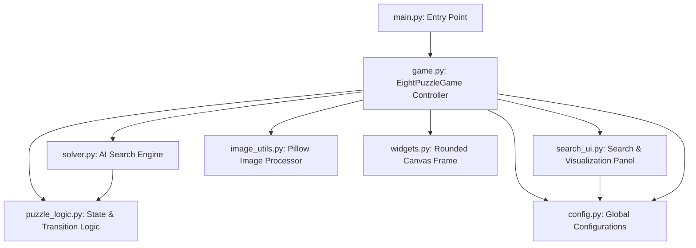

# 8-PUZZLE GAME & AI SEARCH ALGORITHMS BENCHMARK

> **Dự án mô phỏng trò chơi 8-Puzzle kết hợp bộ công cụ trực quan hóa và đối chuẩn hiệu năng các thuật toán tìm kiếm kinh điển trong Trí tuệ Nhân tạo.**

**8-Puzzle là bài toán kinh điển chuẩn mực đại diện cho:**
- **Không gian trạng thái lớn**: Không gian tìm kiếm có $9! / 2 = 181,440$ trạng thái hợp lệ có thể giải được.
- **Tính toán đồ thị và cây tìm kiếm**: Mỗi trạng thái là một đỉnh (node), mỗi nước đi là một cạnh (edge) có trọng số.
- **Môi trường lý tưởng để kiểm chứng các thuật toán tìm kiếm**: Từ tìm kiếm mù (Uninformed Search) đến tìm kiếm có thông tin định hướng (Informed Heuristic Search).

## 1. KIẾN TRÚC & CÔNG NGHỆ SỬ DỤNG

Dự án được xây dựng theo kiến trúc hướng module phân tách rõ ràng (**Separation of Concerns - SoC**), tách rời độc lập giữa tầng xử lý logic cốt lõi, tầng thuật toán giải tự động và tầng giao diện hiển thị.



### 1.1. Ngôn ngữ & Công nghệ Cốt lõi
| Thành phần | Công nghệ / Thư viện | Vai trò trong hệ thống |
| :--- | :--- | :--- |
| **Ngôn ngữ chính** | **Python 3.x** | Toàn bộ mã nguồn backend, frontend và thuật toán. |
| **Giao diện đồ họa (GUI)** | **Tkinter & TTK** | Dựng cửa sổ ứng dụng desktop hiện đại, xử lý sự kiện chuột/phím, tích hợp thanh cuộn, combobox và treeview. |
| **Giao diện tùy biến (Custom UI)** | **Tkinter Canvas (Custom `RoundedFrame`)** | Vẽ hình khối thẻ bo góc mịn (border radius), tạo phong cách thẻ (card layout) thanh lịch, vượt qua giới hạn cứng nhắc của Tkinter mặc định. |
| **Xử lý hình ảnh (Computer Vision)** | **Pillow (PIL)** | Tải ảnh từ máy tính, tự động crop và resize tỷ lệ vuông với thuật toán nội suy cao cấp `Image.Resampling.LANCZOS`, cắt ảnh thành lưới 9 mảnh ghép. |
| **Cấu trúc dữ liệu tối ưu** | `collections.deque`, `heapq`, `itertools`, `set`, `dict`, `tuple` | Tối ưu hóa bộ nhớ và tốc độ truy vấn: Hàng đợi FIFO $O(1)$, Min-Heap $O(\log N)$, Bảng băm $O(1)$, Tuple bất biến làm State Hash. |

## 2. HỆ THỐNG TÍNH NĂNG CHI TIẾT (Folder screenshots)

## 3. NGUYÊN LÝ CÁC THUẬT TOÁN AI ĐƯỢC TRIỂN KHAI

| Thuật toán | Cơ chế hoạt động | Cấu trúc dữ liệu | Tính đầy đủ (Complete) | Tính tối ưu (Optimal) | Độ phức tạp thời gian | Độ phức tạp không gian |
| :--- | :--- | :--- | :---: | :---: | :---: | :---: |
| **BFS** | Mở rộng theo từng tầng (Level-by-level) | Hàng đợi FIFO (`deque`) | Có | Có (nếu chi phí bằng nhau) | $O(b^d)$ | $O(b^d)$ *(Rất tốn RAM)* |
| **DFS** | Đi sâu theo nhánh, quay lui (Backtracking) | Ngăn xếp / Đệ quy Call Stack | Có (với Depth Limit) | Không | $O(b^m)$ | $O(b \cdot m)$ *(Tiết kiệm RAM)* |
| **UCS** | Mở rộng nút có tổng chi phí $g(n)$ nhỏ nhất | Hàng đợi ưu tiên (`heapq`) | Có | Có | $O(b^{1 + \lfloor C^* / \epsilon \rfloor})$ | $O(b^{1 + \lfloor C^* / \epsilon \rfloor})$ |
| **Greedy** | Mở rộng nút có $h(n)$ nhỏ nhất (ước lượng gần đích nhất) | Hàng đợi ưu tiên (`heapq`) | Không | Không | $O(b^m)$ | $O(b^m)$ *(Thường chạy rất nhanh)* |
| **A\*** | Mở rộng nút có $f(n) = g(n) + h(n)$ nhỏ nhất | Hàng đợi ưu tiên (`heapq`) | Có | Có (nếu $h$ hợp lệ - *admissible*) | $O(b^d)$ | $O(b^d)$ |

### Chi tiết các hàm Heuristic
1. **Manhattan Distance ($h_1$)**:
   $$h_{Manhattan}(S) = \sum_{i=1}^{8} \left( |x_i - x_i^*| + |y_i - y_i^*| \right)$$
   - Đo tổng số bước di chuyển theo chiều ngang và dọc để đưa mỗi ô $i$ về vị trí đích $(x_i^*, y_i^*)$.
   - Là một hàm heuristic hợp lệ (*Admissible*: $h(n) \le h^*(n)$) và nhất quán (*Consistent*), đảm bảo nghiệm của A* luôn tối ưu số bước.
2. **Misplaced Tiles ($h_2$)**:
   $$h_{Misplaced}(S) = \sum_{i=1}^{8} \mathbb{I}(current\_pos(i) \neq goal\_pos(i))$$
   - Đếm số lượng ô đang không nằm đúng vị trí đích.
   - Thường yếu hơn (ít thông tin hơn) so với Manhattan ($h_{Misplaced}(n) \le h_{Manhattan}(n)$), giúp người học nhận thấy rõ sự chênh lệch về số lượng nút phải duyệt của A* và Greedy khi đổi heuristic.

---

## 4. KỸ NĂNG ĐẠT ĐƯỢC THÔNG QUA DỰ ÁN

Dự án này **hỗ trợ trực tiếp và đắc lực** cho sinh viên chuyên ngành **Trí tuệ nhân tạo (AI)**, **Khoa học máy tính (CS)** và **Kỹ thuật phần mềm (SE)**:

### 4.1. Nắm vững Nền tảng Tìm kiếm trong Không gian Trạng thái (State Space Search)
- Hiểu sâu sắc cách một bài toán đời thực được trừu tượng hóa thành mô hình toán học AI:
  - **Trạng thái (State)**: Được biểu diễn bằng cấu trúc dữ liệu nhẹ `tuple` có thứ tự.
  - **Hàm kế tiếp (Successor Function)**: Kiểm tra tọa độ biên và sinh trạng thái lân cận hợp lệ.
  - **Mô hình chi phí (Cost Model)**: Chi phí thực $g(n)$ và hàm đánh giá $f(n)$.
- Phân biệt rõ ràng giữa **Tìm kiếm mù (Uninformed Search)** và **Tìm kiếm có thông tin (Informed Search)**.

### 4.2. Kỹ năng Thiết kế Heuristic & Lý thuyết Đồ thị
- Thấu hiểu thế nào là một Heuristic **hợp lệ (Admissible)** và **nhất quán (Consistent/Monotonic)**.
- Hiểu cơ chế tại sao heuristic "trội hơn" (*dominating heuristic*) như Manhattan lại giảm thiểu đáng kể số nút mở rộng (`expanded_count`) so với Misplaced Tiles.

### 4.3. Cấu trúc Dữ liệu & Kỹ thuật Lập trình Thuật toán Cấp cao
- **Min-Heap với Tie-Breaking**: Xử lý triệt để bài toán va chạm độ ưu tiên trong Priority Queue (`heapq`) bằng cách chèn bộ đếm tự tăng `itertools.count()`, tránh lỗi so sánh tuple không mong muốn trong Python.
- **Hash-Set Tra cứu $O(1)$**: Tối ưu hóa việc loại trừ trạng thái lặp và chu trình (Cycle Detection), quản lý danh sách `frontier` và `explored/closed`.
- **Truy vết Lời giải (Parent Pointers Tracking)**: Kỹ thuật lưu vết cha-con trong Dictionary để phục hồi đường đi từ đích ngược về gốc với độ phức tạp thời gian tối thiểu.

### 4.4. Kỹ nghệ Phần mềm & Tư duy Thiết kế (Software Engineering)
- **Kiến trúc phân tầng sạch sẽ**: Không để logic AI phụ thuộc vào thư viện đồ họa GUI.
- **Xử lý bất đồng bộ & Animation mượt mà**: Ứng dụng vòng lặp sự kiện Tkinter (`root.after`), không làm treo giao diện (UI Freeze) khi diễn hoạt lời giải.

---

## 5. HƯỚNG DẪN CÀI ĐẶT & CHẠY ỨNG DỤNG

### 5.1. Yêu cầu hệ thống
- **Python**: Phiên bản `3.8` trở lên.
- **Thư viện bên ngoài**: `Pillow` (hỗ trợ xử lý ảnh cho chế độ chơi Image Puzzle).

### 5.2. Cài đặt thư viện
Mở Terminal hoặc Command Prompt tại thư mục dự án và chạy lệnh:
```bash
python -m pip install pillow
```

### 5.3. Khởi chạy ứng dụng
Chạy lệnh sau để mở game:
```bash
python main.py
```